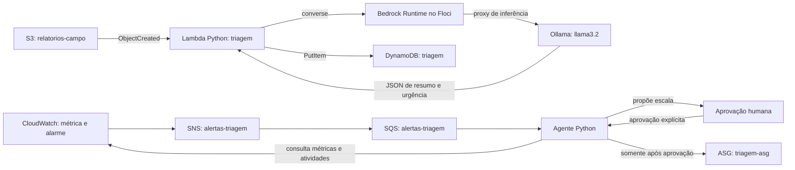

# GenAI na Automação de Serviços AWS

Projeto prático de automação em nuvem com IA generativa, utilizando Floci e Ollama como ambiente local simulado da AWS.

## Etapa 0 - Ambiente local

### Componentes utilizados

- Docker Desktop 29.9.3
- Python 3.14.10
- AWS CLI 2.40.3
- Floci, simulando serviços AWS localmente
- Ollama com o modelo local `llama3.2`

### Arquitetura inicial

```text
AWS CLI -> Floci (localhost:4566) -> Bedrock Runtime simulado -> Ollama (llama3.2)
```

## Objetivo

Experimentar automação de triagem de relatórios agrícolas com IA generativa, usando APIs AWS simuladas pelo Floci e inferência local pelo Ollama. O projeto também exercita documentação via MCP, IaC, observabilidade e controles de segurança.

## Execução resumida

1. Inicie o ambiente local:

   ```powershell
   docker compose up -d
   docker compose exec ollama ollama pull llama3.2
   ```

2. Ative o perfil AWS local previamente configurado para o Floci:

   ```powershell
   $env:AWS_PROFILE = "floci"
   ```

3. Configure a função `triagem` com `TABELA=triagem` e o evento S3 descrito em [lambda/notificacao-s3.json](./lambda/notificacao-s3.json). Envie os relatórios de teste ao bucket `relatorios-campo` e confira os resultados na tabela `triagem`.
4. Com a Launch Configuration `triagem-launch-v1` e o ASG `triagem-asg` criados no Floci, execute o agente sem aprovação:

   ```powershell
   .\.venv\Scripts\python.exe .\agent\triagem_agente.py --grupo triagem-asg --fila alertas-triagem --limite 10
   ```

   No teste, o agente recomendou escalar de `1` para `2`, mas não alterou a capacidade sem aprovação.
5. Após revisar e aprovar explicitamente a recomendação, execute novamente com a opção de aprovação:

   ```powershell
   .\.venv\Scripts\python.exe .\agent\triagem_agente.py --grupo triagem-asg --fila alertas-triagem --limite 10 --aprovar-escalonamento
   ```

   Neste teste, o agente alterou a capacidade desejada para `2`, que foi confirmada no ASG.
6. Ao terminar os testes, encerre os serviços locais com `docker compose down`.

## Arquitetura



## Etapas do projeto

- **Etapa 0 — Ambiente local:** Floci, Ollama e Docker Compose.
- **Etapa 1 — Fundamentos:** conceitos de GenAI, classificação de serviços e MCP para consultar documentação.
- **Etapa 2 — Prompts:** diário preparado, com conteúdo ainda pendente.
- **Etapa 3 — Infraestrutura:** especificação e template CloudFormation para VPC, EC2, S3 e DynamoDB.
- **Etapa 4 — Triagem:** evento S3 aciona Lambda, que usa Bedrock Runtime/Ollama e grava resultados na tabela; os testes de relatórios estão registrados em [docs/etapa-04-automacao.md](./docs/etapa-04-automacao.md).
- **Etapa 5 — Escalabilidade e alertas:** Launch Configuration `triagem-launch-v1`, ASG `triagem-asg` (1–4 instâncias), alarme acionado pela métrica de valor `25` com limite `10`, entrega SNS/SQS e escala de `1` para `2` somente após aprovação humana. As evidências locais estão em [docs/etapa-05-evidencias.md](./docs/etapa-05-evidencias.md).
- **Etapa 6 — Análise:** custos, segurança, LGPD, sustentabilidade e limitações, em [docs/etapa-06-analise.md](./docs/etapa-06-analise.md).

## MCP e documentação

O arquivo `.mcp.json` configura o `awsDocs` como servidor local via `stdio`/`uvx` e o `awsKnowledge` via HTTP. Eles apoiam a consulta à documentação; não substituem o Floci nem comprovam comportamento de serviços AWS reais.

## Validações locais já realizadas

Lint do template de infraestrutura:

```powershell
.\.venv\Scripts\cfn-lint.exe .\iac\vpc.yaml
```

Verificação sintática do inventário:

```powershell
.\.venv\Scripts\python.exe -m py_compile .\scripts\inventario.py
```

Verificação sintática da Lambda e do agente:

```powershell
.\.venv\Scripts\python.exe -c "from pathlib import Path; files=[r'lambda\app.py', r'agent\triagem_agente.py']; [compile(Path(name).read_text(encoding='utf-8'), name, 'exec') for name in files]; print('Sintaxe Python: OK')"
```

Também foram feitas verificações sintáticas e testes com serviços simulados para a Lambda e o agente. Os testes do agente cobriram a decisão segura quando a resposta é inválida, a ausência de escala sem aprovação e a chamada de escala somente com a aprovação explícita.

## Segurança e ambiente

Este é um ambiente local Floci/Ollama; não representa um deploy em AWS real. Não versione credenciais nem inclua valores secretos no código. Use o perfil local configurado para o Floci.