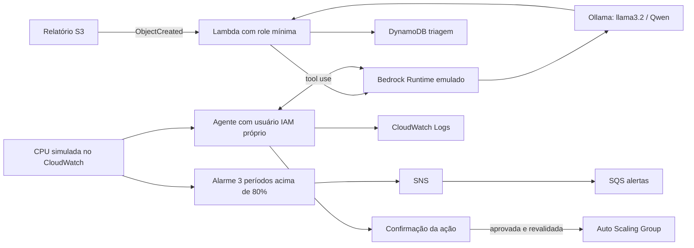

# GenAI na Automação de Serviços AWS

Laboratório local de triagem de relatórios agrícolas e diagnóstico operacional. Floci emula as APIs AWS; Ollama executa llama3.2 na triagem e qwen2.5:3b no agente. Há dois usos de IA: classificação de documentos e agente com escolha de ferramentas.

## Preparar no Windows

Requisitos: Docker Desktop ativo, Python, AWS CLI, Git. Para o MCP, uv/uvx e cliente compatível. Na raiz do repositório:

```powershell
powershell -ExecutionPolicy Bypass -File scripts/preparar.ps1
```

O script inicia contêineres, baixa llama3.2 e qwen2.5:3b, configura o perfil LOCAL floci, cria .venv, instala dependências, valida IaC e provisiona a stack e recursos auxiliares. Se os contêineres já estão ativos nesta máquina, use `-SemDocker`. Não execute duas cópias do Compose nas mesmas portas. A implantação verifica a conta 000000000000. Chaves geradas ficam em ~/.aws, nunca no repositório. O AMI fictício usado no provisionador só funciona na emulação.

## Validar e demonstrar

```powershell
.\.venv\Scripts\python.exe -m unittest discover -s tests -v
.\.venv\Scripts\python.exe scripts/testar_iam.py
.\.venv\Scripts\python.exe scripts/validar_local.py
.\.venv\Scripts\python.exe scripts/demonstrar_agente.py --recusar
```

O último comando é um teste de recusa automática. Para demonstração interativa, execute sem `--recusar`: o operador deve conferir o grupo, capacidade e justificativa e digitar `s` apenas se aprovar aquela ação. O agente só aceita aumento de uma unidade, CPU >80% em três períodos consecutivos recentes e no máximo uma alteração por execução. Falha na auditoria impede escrita. O modelo escolhe ferramentas; respostas incorretas podem ser bloqueadas. A execução tem limite de seis rodadas.

`validar_local.py` envia três relatórios legítimos e um com tentativa de injeção, mede tokens/latência e salva resultados em docs/evidencias. São objetos de teste com nomes únicos. `testar_iam.py` cria e remove apenas sua identidade e objetos temporários. Para inventário: definir `$env:AWS_PROFILE='floci'` e executar `scripts/inventario.py`.

## Arquitetura



A fila recebe alertas. O agente é iniciado manualmente e consulta métricas/ASG; não há consumidor automático da SQS nesta versão. A infraestrutura básica está em iac/vpc.yaml; scripts/provisionar.py configura Lambda, IAM, eventos, ASG, alarme e notificações.

## Documentação da entrega

- [Fundamentos](docs/etapa-01-fundamentos.md), [diário reconstruído](docs/etapa-02-diario-prompts.md).
- [Especificação IaC](docs/etapa-03-especificacao.md) e [revisão crítica](docs/etapa-03-revisao.md).
- [Triagem](docs/etapa-04-automacao.md), [agente](docs/etapa-05-especificacao.md), [evidências](docs/etapa-05-evidencias.md).
- [Custos, segurança e sustentabilidade](docs/etapa-06-analise.md), [roteiro de 10 minutos](docs/roteiro-apresentacao.md).
- [Origem das evidências](docs/evidencias/README.md) e [estado da entrega](docs/estado-entrega.md).

## MCP

`.mcp.json` atende clientes que usam mcpServers; `.vscode/mcp.json` atende o VS Code. Ambos definem awsDocs via stdio/uvx e awsKnowledge via HTTP. Reinicie o editor após instalar uv para atualizar PATH. As capturas históricas mostram descoberta de cinco ferramentas por servidor. MCP consulta documentação; não substitui testes do código.

## Limites e encerramento

Os testes são locais, sem deploy AWS real. A versão do Floci exigiu exceção isolada `logs:PutLogEvents` em `*`, documentada em policies/agente-floci-compat.json; remover na AWS e validar o escopo por stream. O modelo pode gerar conclusões erradas mesmo com ferramentas. Regex de injeção é uma defesa parcial, não imunidade.

Após apresentar, `docker compose down` encerra os serviços principais. Recursos auxiliares Docker criados pelo Floci e dados persistidos podem continuar existindo; conferir `docker ps -a`. Não apagar volumes/dados antes de preservar as evidências. Nenhuma limpeza destrutiva foi executada nesta revisão.
